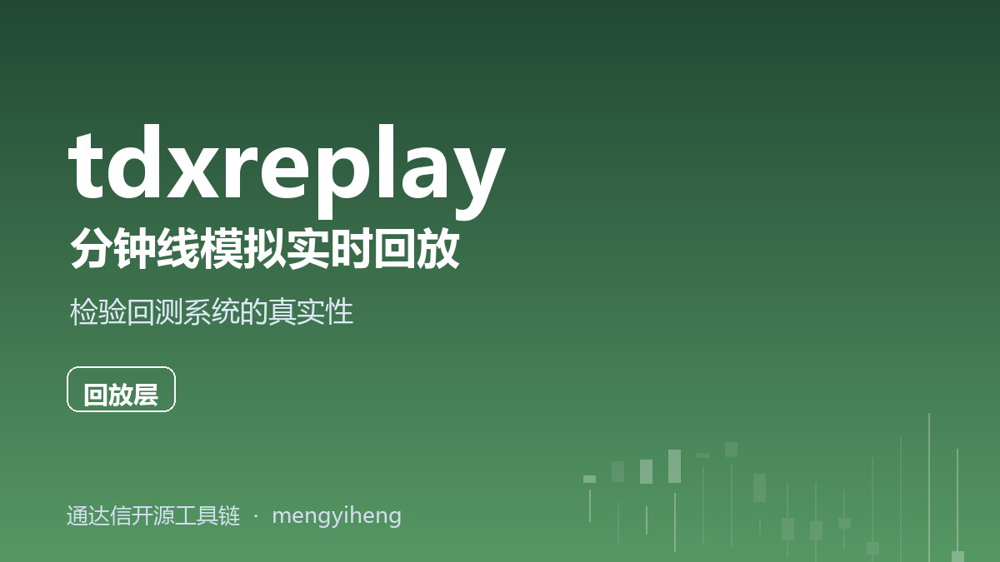
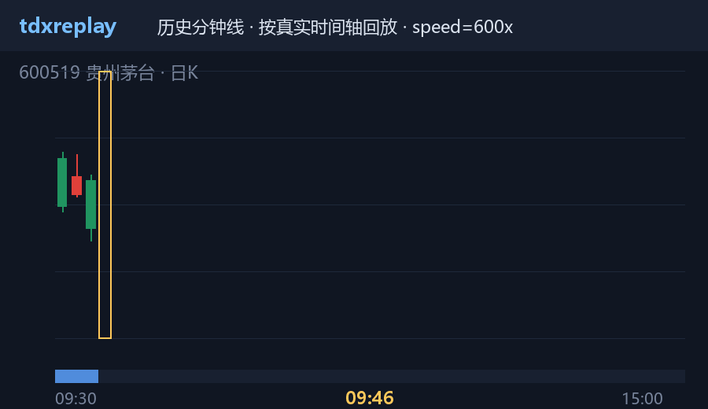

<p align="center"></p>

<p align="center"></p>

# tdxreplay — 通达信本地分钟线模拟实时回放

**目的：帮检验回测系统的真实性。**

回测和实盘最大的差别不是数据，而是**数据的到达方式**：实盘里你只能逐根看到
"当时刚刚走完"的 K 线，而回测框架常常不小心用到了未来数据。`tdxreplay` 把通达信
本地分钟线（`.lc1` / `.lc5`）按**真实时间轴**逐根重放成模拟实时行情流，让你的
策略/回测代码在历史时段接受与实盘**同构**的输入——如果它平时偷看了未来，
回放时行为立刻不一样。

- ⏱ **真实时间轴重放**：速度 1x（实时）/ 60x / 任意倍率 / 全速
- 🔀 **多股合并**：多只股票的分钟线按时间严格排序成一条流
- ⏸ **午休/跳空压缩**：11:30–13:00 等空档自动限速，不会干等 90 分钟
- 🔌 **三种消费接口**：Python 生成器 / 回调 / HTTP SSE（纯标准库实现）
- 🪶 只依赖 [tdxdata](https://gitee.com/mengyiheng/tdxdata)（读 `.lc1/.lc5`）
- 🚫 **不含任何策略和算法**——它只负责"假装现在是当时"

## 安装

```bash
pip install tdx-data tdxreplay
# 或从 Gitee 安装最新版
pip install git+https://gitee.com/mengyiheng/tdxreplay.git
```

## 快速开始

### 1. 终端回放（先看看数据长什么样）

```bash
tdxreplay run --vipdoc D:\new_tdx64\vipdoc --codes 600519,000001 ^
              --date 2026-10-19 --speed 600
```

### 2. Python：把回放喂给你的实盘处理函数

```python
from tdxreplay import ReplaySession

session = ReplaySession(r"D:\new_tdx64\vipdoc", ["600519", "000001"],
                        trade_date="2026-10-19", speed=600)

for ev in session:                 # ev.code / ev.market / ev.bar / ev.pace_seconds
    handle_bar(ev.code, ev.bar)    # ← 与实盘完全相同的处理函数
```

检验方法：把同一天的**回放结果**与**实盘采集记录**逐根比对——若你的系统在
两种模式下给出的信号不一致，说明存在未来函数或状态泄漏。

### 3. HTTP SSE 模式（喂给任何语言写的回测/交易系统）

```bash
tdxreplay serve --vipdoc D:\new_tdx64\vipdoc --codes 600519 --date 2026-10-19 --speed 60
# 行情流: http://127.0.0.1:8640/stream  (每行一个 JSON K 线)
```

客户端示例：

```python
import urllib.request
for line in urllib.request.urlopen("http://127.0.0.1:8640/stream"):
    if line.startswith(b"data: "):
        bar = json.loads(line[6:])
        ...
```

### 4. 查看本地数据覆盖哪些交易日

```bash
tdxreplay dates --vipdoc D:\new_tdx64\vipdoc --code 600519
```

## 数据准备

`tdxreplay` 读取通达信收盘后下载的分钟线：

```
<vipdoc>/sh/minline/sh600519.lc1
<vipdoc>/sz/minline/sz000001.lc1
```

在通达信客户端：`系统 → 盘后数据下载 → 勾选 1/5 分钟线`。

## API 一览

```python
ReplaySession(vipdoc, codes, trade_date=None, speed=1.0,
              max_gap_seconds=60, kinds="lc1")
    .__iter__()        # -> Iterator[ReplayEvent]
    .run(on_bar, on_end=None)  # -> int (根数)
list_dates(vipdoc, code)  # -> ["2026-10-14", ...]
```

`ReplayEvent` 字段：`code` `market` `bar`(tdxdata.MinuteBar) `index` `pace_seconds`。

## 免责声明

本项目仅做本地数据文件的按时间轴重放，不提供任何行情数据，不构成任何投资建议。
使用前请[阅读完整免责声明](DISCLAIMER.md)。

## 量化相关定制需求

承接回放系统对接、实盘/回放一致性校验工具、数据管线搭建等定制开发，
联系见 [Gitee Issues](https://gitee.com/mengyiheng/tdxreplay/issues)。

## License

MIT

## 量化相关定制需求

作者承接回放与一致性验证方向的定制开发：

| 方向 | 示例 |
|---|---|
| ⏱ 回放工程化 | tick 级重放、多日连续回放、WebSocket 推送、回放加速集群 |
| ✅ 一致性校验 | 实盘/回放信号逐根比对工具、未来函数检测报告 |
| 🛠 私有部署 | 与你现有回测框架的适配层开发 |

**联系合作**：[Gitee Issues](https://gitee.com/mengyiheng/tdxreplay/issues) 或 [Gitee 私信](https://gitee.com/mengyiheng)。
